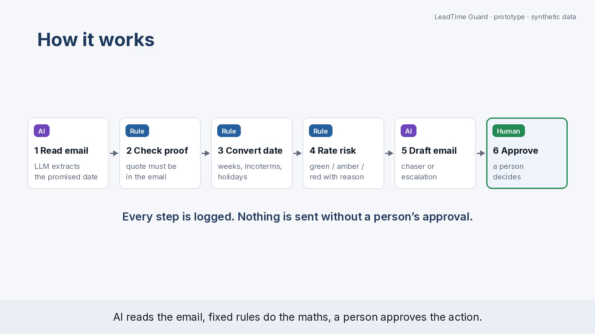
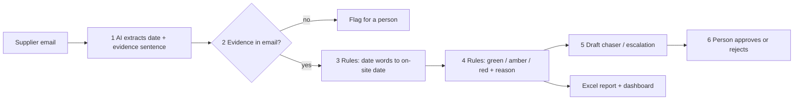
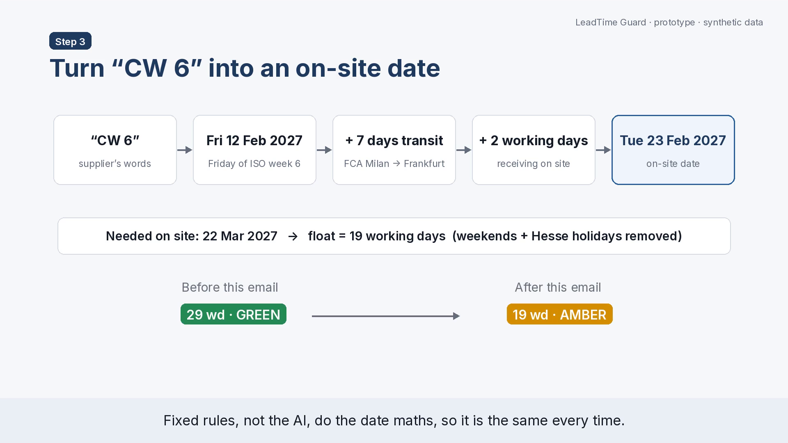
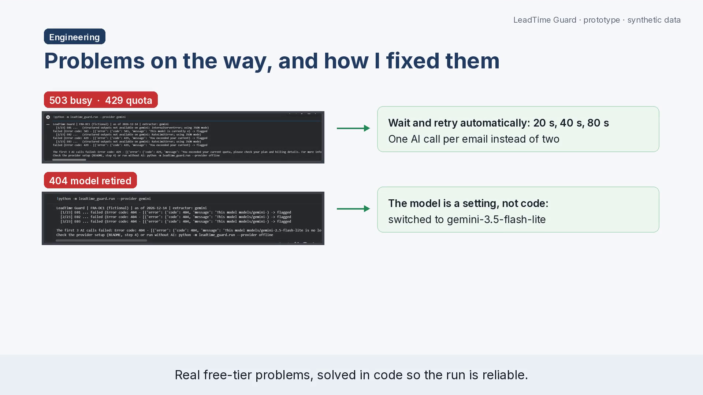
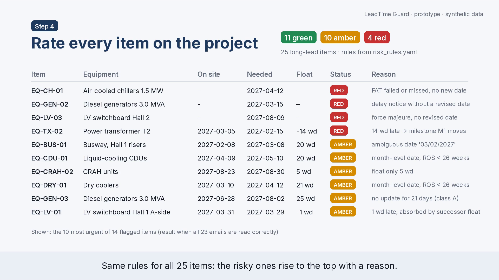

# LeadTime Guard

**An AI agent that catches late long-lead equipment on data-centre builds before it delays power-on.**

LeadTime Guard reads supplier emails about big electrical and cooling equipment (transformers, switchgear, generators, chillers), extracts the promised date **with the sentence that proves it**, turns vague dates like *"CW 6 at our Milan works"* into a real on-site date with fixed rules, rates every item **green / amber / red with a reason**, and drafts chaser or escalation emails that **a person approves**. Nothing is sent automatically.

> **AI reads. Rules decide. A person approves.**
> Built for a fictional 2-hall data centre near Frankfurt (FRA-DC1). All companies, people and data are synthetic.

   🌐 **Live dashboard:** [open the app (no install needed)](https://leadtime-guard-appaogezu5elk34djnbuvh9.streamlit.app/)

🎬 **3-minute demo video (incl. the real Colab run and the fixes):** [`docs/demo/LeadTime_Guard_prototype.mp4`](docs/demo/LeadTime_Guard_prototype.mp4)



---

## The problem

- Transformers and switchgear for data centres can take **many months to more than two years** to arrive. One late item can delay energisation of a whole hall.
- Suppliers send updates as **free-text emails with vague or tricky dates**: "CW 6", "Q2 2027", "ready for collection at our works", "subject to drawing approval", "03/02/2027", partial shipments, force majeure.
- Teams **retype these dates into Excel** and compare them with the schedule by hand. Reading *"ready at our works in CW 6"* as a site date makes a late item look safe.

## How it works



| Step | Who | What happens |
|---|---|---|
| 1 Read | **AI** (free LLM via OpenCode, Gemini, Ollama or Groq) | Copies the promised date **exactly as written**, the date basis (site / works / port), status and flags (delay, force majeure, FAT failed, partial shipment) into a Pydantic JSON schema |
| 2 Check | **Rule** | The evidence sentence must really appear in the email; otherwise retry once, then flag for a person |
| 3 Convert | **Rule** | ISO calendar weeks (incl. CW 53), quarters, "early / late March", German and slash dates, Incoterms (DAP, FCA, FOB, CIF), transit days and **Hesse public holidays** |
| 4 Rate | **Rule** | Thresholds in [`config/risk_rules.yaml`](config/risk_rules.yaml): milestone moves → red; float < 20 working days, vague date near ROS, stale update or ambiguous date → amber |
| 5 Draft | Template | Chaser (amber), escalation (red), or an **internal note only** for force majeure |
| 6 Approve | **Person** | `approve` command or dashboard buttons; every decision is logged. `auto_send = false` |

### Example: why "CW 6" is not safe



The supplier says the switchgear is *ready for collection at our Milan works in CW 6*. That is a hand-over date, not a site date: Friday of ISO week 6 (12 Feb 2027) + 7 days transit + 2 working days receiving = **on site Tue 23 Feb 2027**, leaving **19 working days** before it is needed. The item turns from green to **amber**, with the reason written out.

---

## Results on the synthetic test set

The test set has **23 supplier emails** for **25 equipment items**, with **planted traps** (see table below). The expected colour of every item is in [`data/answer_key/expected_risk.csv`](data/answer_key/expected_risk.csv): the true facts run through the same rules. So the evaluation measures **whether the extractor reads the emails correctly**.

Key metric: **missed-risk rate** = truly amber/red items that were rated green ÷ all truly amber/red items (target: at most 1 in about 20).

| Extractor | Missed risks (of 14) | Missed-risk rate | Red recall | Right colour | Date read correctly |
|---|---|---|---|---|---|
| Offline baseline (regex, no AI) | 2 | 14.3 % | 100 % | 88 % | 82.6 % |
| **AI (Gemini `gemini-3.5-flash-lite`, free tier)** | **0** | **0.0 %** | **100 %** | **96 %** | **100 %** |

The baseline takes the first date it finds, so it falls for the **superseded date** (E01) and the **partial shipment** (E23) traps, and both risky items look green. **The AI caught both: 0 missed risks, every date read correctly, and every evidence sentence found in its email.** Its one difference was a false alarm, not a miss: it read "ETA Hamburg port 19 March" as a tentative date, so the battery cabinets (EQ-BAT-01) came out amber instead of green. Run: 23 AI calls, about 23,400 input + 2,900 output tokens, cost €0. Full reports: [`evals/results/eval_gemini.md`](evals/results/eval_gemini.md), [`evals/results/eval_offline.md`](evals/results/eval_offline.md).





### The planted traps

| Email | Trap |
|---|---|
| E01, E16 | superseded date appears before the current one |
| E02 | quoted older email contains an old date |
| E03, E17 | works date (FCA), not a site date |
| E04, E06 | German `27.01.2027` and unambiguous `18/02/2027` |
| E05, E18 | quarter-level date ("Q1 2027"), sometimes with a condition |
| E07 | ambiguous `03/02/2027` (3 Feb or 2 Mar?) → never guessed, flagged |
| E08 | CW 53 at the year boundary; Friday 1 Jan 2027 is a holiday |
| E09 | delay notice **without** a new date |
| E10, E11, E12 | FOB / CIF dates + sea transit; one arrival lands on Easter |
| E13 | FAT failed, no new date |
| E14 | German "KW 9" without a year |
| E15 | vague "early March 2027" |
| E19 | FAT date appears before the delivery date |
| E20 | force majeure → internal note only, no reply drafted |
| E21 | tentative date far from the need date |
| E23 | partial shipment → the **last** date completes the item |

---

## Run it on Windows (about 15 minutes)

**1. Get the code and create a Python 3.12 environment** (very new Python versions may not have ready-made pandas/numpy packages yet)
```
cd C:\projects\leadtime-guard
py -3.12 -m venv .venv
.venv\Scripts\activate
python -m pip install --upgrade pip
pip install -r requirements.txt
pip install -e .
```

**2. Run the tests** → `30 passed`
```
pytest -q
```

**3. Run the pipeline without AI** (offline baseline, works everywhere)
```
python -m leadtime_guard.run
start outputs\offline\LeadTime_Guard_report.xlsx
```

**4. Choose a free AI model** (OpenCode CLI must be installed; pick a model whose name ends in `-free`)
```
opencode models
setx LTG_PROVIDER "opencode"
setx LTG_MODEL "opencode/<free-model-from-the-list>"
```
Close and reopen the terminal, then `cd` to the folder and run `.venv\Scripts\activate` again.
Backups, also free: Gemini free tier (`setx GEMINI_API_KEY "..."`, provider `gemini`) or Ollama on your laptop (provider `ollama`).

**5. Run with AI** (23 emails, a few seconds each)
```
python -m leadtime_guard.run --provider opencode
```

**6. Evaluate the AI against the answer key**
```
python -m leadtime_guard.evaluate --provider opencode
```
Copy the numbers into the results table above.

**7. Approve or reject the draft emails** (nothing is sent)
```
python -m leadtime_guard.approve --provider opencode
```

**8. Dashboard**
```
streamlit run app/dashboard.py
```

Optional: run it every morning with n8n, see [`n8n/README.md`](n8n/README.md).

---

## Project structure

```
config/          project.yaml (as-of date, Hesse holidays, transit days, date rules), risk_rules.yaml (thresholds)
data/register/   equipment_register.csv (25 items), milestones.csv (5 milestones)
data/emails/     E01-E23 synthetic supplier emails
data/answer_key/ extraction_key.csv (true facts per email + trap), expected_risk.csv (expected colour per item)
src/leadtime_guard/
  extract/       llm_extractor.py (AI), baseline.py (regex, no AI), grounding.py (evidence check)
  llm/           client.py (provider switch), opencode_cli.py (OpenCode CLI), cost.py (token count)
  normalise/     dates.py (weeks, quarters, month parts, Incoterms, holidays)
  rules/         engine.py (green / amber / red with reasons)
  actions/       drafts.py (chaser, escalation, internal note)
  report/        report.py + excel_style.py (Excel with colours)
  pipeline.py    run.py  evaluate.py  approve.py
app/             dashboard.py (Streamlit)
evals/           harness.py (missed-risk rate, confusion matrix), results/
tests/           30 tests: dates, rules, grounding, metrics, full offline run
n8n/             optional daily workflow
docs/            problem.md, assumptions.md, demo video, images, sample output
```

## Tools

Python 3.12 · OpenCode CLI (free LLM; Gemini / Ollama / Groq as backups) · Pydantic (JSON schema) · pandas + NumPy (working days with Hesse holidays) · YAML rules · openpyxl (Excel report) · Streamlit (dashboard) · pytest (tests) · n8n (optional scheduling). **Running cost: €0.**

## Design decisions

- **The AI only reads.** It copies date words exactly and never calculates. Date maths and risk rules are fixed code, so the same email always gives the same result.
- **Evidence or it does not count.** Every extracted value comes with a sentence that must appear in the email.
- **Never guess.** Ambiguous dates, missing evidence and failed calls become amber with a clear reason for a person.
- **People stay in charge.** Every email is a draft; force majeure gets an internal note for a legal check, never an automatic reply.
- **Measured, not claimed.** A synthetic test set with planted traps, an answer key written before the evaluation, and a baseline to compare against.

All assumptions (thresholds, transit days, date conventions) are written down in [`docs/assumptions.md`](docs/assumptions.md). **The green/amber/red thresholds are this project's own assumptions, not an industry standard.**

## Limitations and next steps

- Synthetic emails only (English). Real supplier emails would need a pilot with an answer key built from real cases.
- Free models may log prompts, so they are used only with synthetic data. For real data: a local model (Ollama) or an EU-hosted model under a data processing agreement.
- Next: read emails directly from a shared Outlook mailbox (Microsoft Graph), track date changes over time per supplier, add milestone-level impact (which milestone moves by how many days).

---

*Portfolio project by Abhishek Dubey. All companies, people, emails and the FRA-DC1 project are fictional; email domains use the reserved `.example` ending.*
