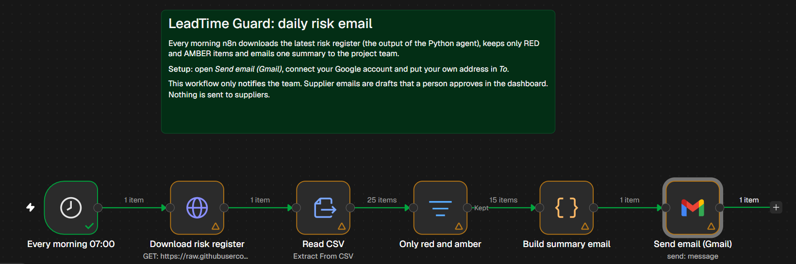
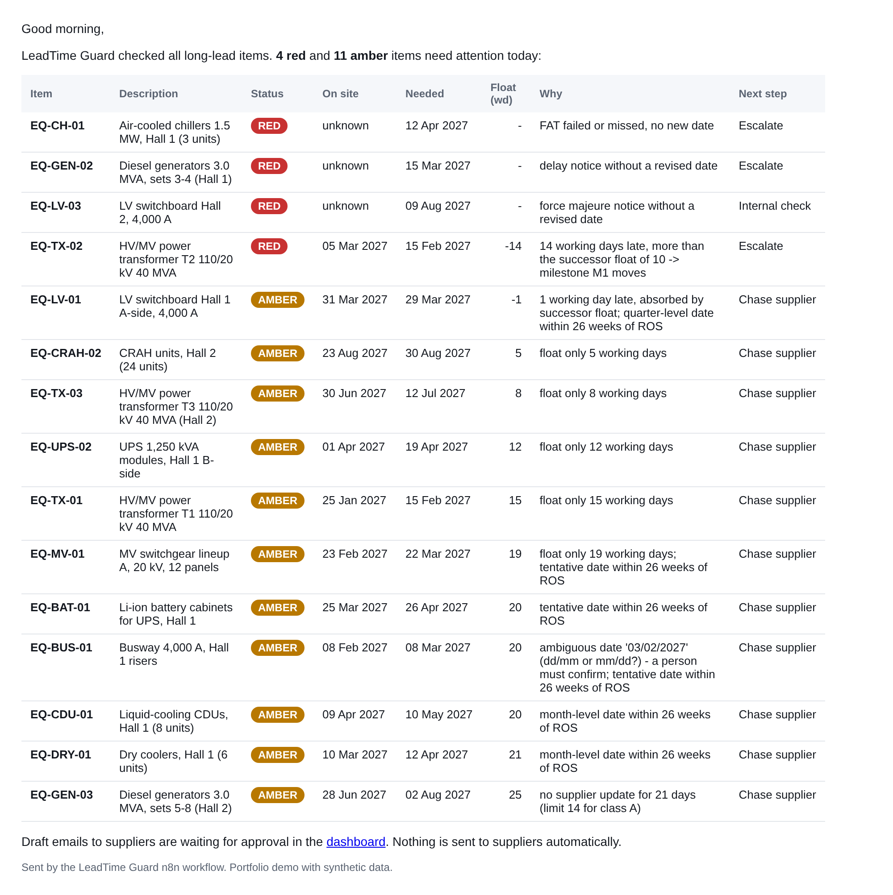

# n8n automation: daily risk email

Every morning an n8n workflow sends the project team **one email with all red and amber items**, so nobody has to open the dashboard to know what is late.

```
Schedule 07:00 → Download risk register (HTTP) → Read CSV → Only red and amber → Build summary email (Code) → Send email (Gmail)
```



Real run on n8n Cloud: 25 items read, 15 red or amber kept, 1 summary email sent.



## What it does and does not do
- **Reads** the latest risk register written by the Python agent (`outputs/gemini/risk_register.csv`).
- **Notifies** the team with a summary table and a link to the [dashboard](https://leadtime-guard-site.vercel.app/dashboard.html).
- If there are no red or amber items, the filter passes nothing and **no email is sent**.
- It **never** writes to suppliers. Supplier emails stay drafts until a person approves them.

In a company setup, the Python pipeline runs on a server (or with a local model, see the main README) shortly before 07:00 and n8n picks up the fresh file from a shared folder or internal URL.

## Try it (free)
1. Start n8n for free on your own computer: install Node.js (LTS), run `npx n8n`, open http://localhost:5678.
2. **Workflows → Import from file →** `n8n/leadtime_guard_daily_email_selfhosted.json`.
3. Open **Send email (SMTP)** → create an SMTP credential (Gmail: `smtp.gmail.com`, port 465, SSL on, your Gmail address and a Google app password) → put your address in **From** and **To**.
4. Click **Execute workflow**. All nodes turn green and the email arrives.
5. Switch the workflow to **Active** to receive it every morning at 07:00 (Europe/Berlin).

## Files
| File | What it is |
|---|---|
| `leadtime_guard_daily_email_selfhosted.json` | the daily risk email workflow, for self-hosted n8n (sends via SMTP) |
| `leadtime_guard_daily_email.json` | the same workflow for n8n Cloud (Gmail node with Google sign-in) |
| `leadtime_guard_daily.json` | older example: runs the Python pipeline itself with an Execute Command node (self-hosted n8n on the same machine only) |
